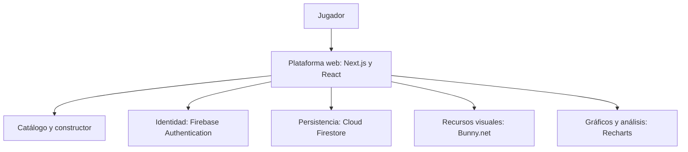

# Tecnologías del proyecto

Mazos y Leyendas combina tecnologías de desarrollo web y servicios en la nube para ofrecer una experiencia interactiva de consulta y construcción de mazos.

## Interfaz web

**Next.js y React** permiten organizar las páginas y construir interacciones como búsqueda de cartas, selección de variantes y edición del mazo. **TypeScript** aporta una estructura común para representar cartas, cantidades y listas.

**Tailwind CSS y Radix UI** apoyan la presentación visual y los componentes de interacción. La interfaz mantiene una identidad temática relacionada con el juego y se adapta a la consulta desde computador y teléfono.

## Identidad y persistencia

**Firebase Authentication** permite gestionar el inicio de sesión. **Cloud Firestore** aporta persistencia para mazos y funciones comunitarias, conectando la experiencia personal con el intercambio de listas.

## Recursos visuales y análisis

**Bunny.net** participa en la distribución de imágenes de cartas. **Recharts** permite presentar gráficos de composición y datos de la plataforma. Las herramientas de exportación visual complementan la presentación de mazos.

## Publicación

**Vercel** proporciona el alojamiento de la aplicación web, disponible a través del dominio de Mazos y Leyendas.

## Visión general

Esta visión presenta los componentes principales de la solución como parte de su descripción académica. El repositorio público está dedicado a la presentación y documentación del proyecto.

[Volver al índice](README.md)
