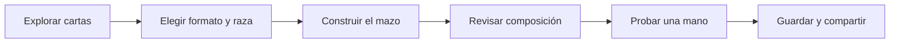

# Mazos y Leyendas

**Plataforma web para consultar cartas, construir mazos y explorar estrategias de Mitos y Leyendas de Primera Era.**

Mazos y Leyendas reúne catálogo, construcción de mazos y herramientas de análisis en una experiencia accesible desde computador y teléfono. El proyecto nace del interés por acercar herramientas digitales a la comunidad de jugadores y se desarrolla como proyecto Capstone de Ingeniería en Informática.

🌐 [Visitar Mazos y Leyendas](https://mazosyleyendas.cl/) · 📚 [Explorar la documentación](Documentacion/README.md)

## Sobre el proyecto

Preparar un mazo implica buscar cartas, reconocer sus ilustraciones, comparar alternativas y revisar las restricciones del formato. Mazos y Leyendas integra estas actividades para acompañar a jugadores nuevos, reingresantes y habituales durante la preparación de sus estrategias.

La plataforma permite pasar de la consulta de una carta a la construcción de una lista, revisar su composición, probar una mano y compartir propuestas con otros jugadores.

## Objetivos

- Centralizar la consulta de cartas de Primera Era y sus variantes de ilustración.
- Facilitar la creación de mazos en los formatos Racial Edición y Racial Libre.
- Apoyar la construcción mediante controles de composición y restricciones de Ban List.
- Ofrecer un espacio personal para guardar y gestionar mazos.
- Promover el intercambio de estrategias mediante funciones comunitarias.
- Presentar herramientas visuales para explorar la composición y el uso de cartas.

## Funciones principales

| Función | Qué permite hacer |
| --- | --- |
| **Explorador de cartas** | Buscar y filtrar cartas, consultar sus atributos y explorar ilustraciones alternativas. |
| **Constructor de mazos** | Elegir formato y raza, agregar cartas, ajustar cantidades y revisar la composición. |
| **Ban List** | Consultar restricciones y recibir avisos durante la construcción del mazo. |
| **Mis Mazos** | Guardar listas personales, recuperarlas y continuar su edición. |
| **Comunidad** | Explorar mazos publicados, compartir propuestas, votar y comentar. |
| **Vista del mazo** | Revisar distribución de cartas, curva de costes y presentación visual de la lista. |
| **Prueba de mano** | Explorar manos iniciales, realizar mulligan y simular robos. |
| **Estadísticas y análisis** | Consultar distribución y tendencias de uso de cartas y razas dentro de la plataforma. |
| **FAQ** | Acceder a material de consulta sobre reglas y cartas. |

## Una experiencia de principio a fin



El catálogo y las variantes visuales facilitan la elección de cartas. El constructor acompaña la edición con controles y avisos. Las vistas de composición y simulación ayudan a explorar la lista antes de compartirla con la comunidad.

## Tecnologías utilizadas

| Tecnología | Aporte al proyecto |
| --- | --- |
| **Next.js y React** | Desarrollo de la aplicación web y sus interfaces interactivas. |
| **TypeScript** | Organización de los modelos y la lógica de la aplicación. |
| **Tailwind CSS y Radix UI** | Diseño visual y componentes de interfaz. |
| **Firebase Authentication** | Gestión de identidad e inicio de sesión. |
| **Cloud Firestore** | Persistencia de mazos y funciones comunitarias. |
| **Bunny.net** | Distribución de recursos gráficos de cartas. |
| **Recharts** | Representación visual de composición e indicadores. |
| **Vercel** | Alojamiento de la plataforma web. |

## Desarrollo académico

El proyecto integra análisis de requerimientos, diseño de interfaces, modelamiento de datos, desarrollo web, integración de servicios y documentación. El trabajo sigue un enfoque ágil e incremental inspirado en Scrum y adaptado al desarrollo individual.

**Autor:** Tomás Barrueto  
**Carrera:** Ingeniería en Informática  
**Sede:** San Joaquín  
**Contexto:** Proyecto Capstone

## Contenido del repositorio

Este repositorio presenta el proyecto y reúne su documentación y evidencias académicas. El código fuente se mantiene privado.

```text
MazosyLeyendas_Capstone/
├── README.md
├── Documentacion/
│   ├── README.md
│   ├── 01_Presentacion_del_proyecto.md
│   ├── 02_Funcionalidades.md
│   ├── 03_Tecnologias.md
│   └── 04_Desarrollo_academico.md
├── Fase 1/
│   ├── Evidencias Grupales/
│   └── Evidencias Individuales/
└── Fase 2/
    ├── Evidencias Grupales/
    └── Evidencias Individuales/
```

## Documentación del proyecto

| Documento | Contenido |
| --- | --- |
| [Presentación del proyecto](Documentacion/01_Presentacion_del_proyecto.md) | Contexto, público y objetivos. |
| [Funcionalidades](Documentacion/02_Funcionalidades.md) | Recorrido por las herramientas de la plataforma. |
| [Tecnologías](Documentacion/03_Tecnologias.md) | Visión general de las tecnologías utilizadas. |
| [Desarrollo académico](Documentacion/04_Desarrollo_academico.md) | Metodología, competencias y evidencias de Capstone. |

## Créditos

Mitos y Leyendas, sus marcas e ilustraciones pertenecen a sus respectivos titulares. Mazos y Leyendas se presenta como una iniciativa de apoyo a la comunidad y como proyecto académico.
